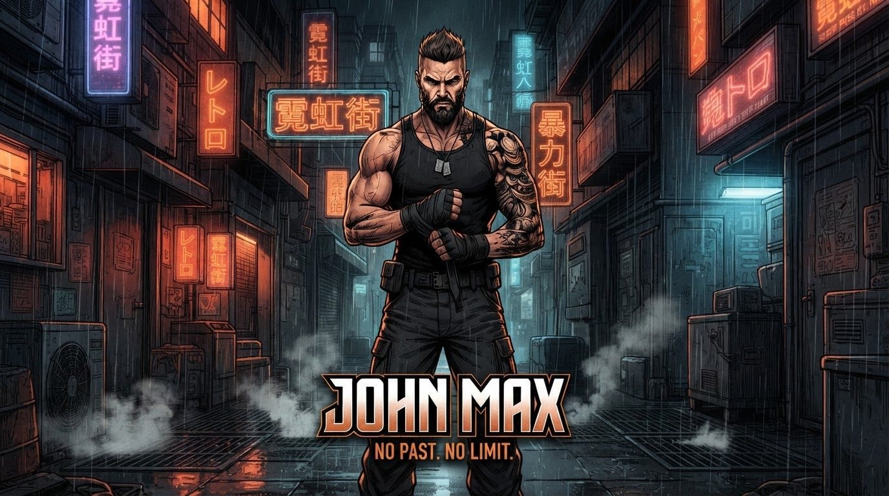

# JOHN MAX — Character Bible v1.0

> **NO PAST. NO LIMIT.**
>
> Un combattant sans origine connue. Un vétéran sans guerre officielle. Un homme qui ne parle pas, ne menace pas et ne gaspille aucun mouvement.

## 1. Identité du personnage

| Attribut | Description |
|---|---|
| Nom | John Max |
| Âge | 38 ans |
| Sexe | Masculin |
| Origine | Inconnue |
| Statut | Combattant indépendant |
| Archétype | Bad boy / Street fighter |
| Univers | Cyberpunk — Neo-Tokyo |
| Tempérament | Vétéran, impassible, méthodique |
| Arme principale | Ses poings |
| Style de combat | Street fighting |
| Rôle | Héros principal jouable |

### Concept narratif

John Max est un combattant qui semble venir de nulle part.

Personne ne connaît véritablement son passé. Il ne revendique aucune affiliation, aucun gang et aucune appartenance militaire.

Il possède pourtant les réflexes, le sang-froid et la maîtrise d'un vétéran.

Il ne cherche pas la confrontation, mais ne recule jamais devant elle.

Son comportement est caractérisé par une économie de mouvement : chaque geste est calculé, chaque coup est précis et chaque combat est abordé comme un problème à résoudre.

### Personnalité

- Silencieux et taciturne.
- Impassible, même sous pression.
- Froid et observateur.
- Méthodique dans ses affrontements.
- Confiant sans être arrogant.
- Dangereux sans avoir besoin de le démontrer.

## 2. Direction artistique

### Univers visuel

Cyberpunk japonais, dans un Neo-Tokyo nocturne, industriel et violent.

L'esthétique recherchée mélange :

- Beat'em up arcade des années 90.
- Cyberpunk japonais.
- Street culture et underground.
- Personnages de comics d'action.
- Ambiance urbaine sombre et industrielle.

Le résultat doit être brutal, lisible et immédiatement identifiable.

### Palette chromatique

| Couleur | Utilisation |
|---|---|
| Noir profond | Tenue principale |
| Orange incandescent | Signature énergétique et éclairages |
| Gris acier | Équipements et accessoires |
| Beige / peau | Contraste organique |

Le noir et l'orange constituent la signature chromatique de John Max.

L'orange doit être utilisé avec parcimonie pour renforcer les contrastes et les impacts visuels.

## 3. Apparence physique

### Morphologie

- Âge apparent : 38 ans.
- Carrure athlétique et puissante.
- Épaules développées.
- Musculature sèche et fonctionnelle.
- Bras particulièrement développés.
- Silhouette nerveuse et mobile.
- Physique de combattant expérimenté.

Il ne doit pas ressembler à un culturiste, mais à un homme dont le corps est construit par des années de combat.

### Visage

- Traits durs et marqués.
- Regard naturel, froid et glacial.
- Aucun implant cybernétique visible.
- Aucune cicatrice.
- Cheveux courts et hérissés.
- Barbe sauvage et relativement dense.

Le visage doit exprimer une forme de détermination permanente, sans colère excessive.

### Tenue

**Haut**
- Débardeur noir ajusté.
- Coupe simple et fonctionnelle.
- Épaules et bras entièrement dégagés.

**Bas**
- Pantalon cargo tactique noir.
- Coupe légèrement ample.
- Poches latérales.
- Ceinture tactique.

**Chaussures**
- Bottes de combat cyberpunk.
- Semelles épaisses.
- Construction robuste.
- Détails techniques discrets.

**Accessoires**
- Dog tags militaires autour du cou.
- Bandages noirs autour des poignets et des mains.

## 4. Tatouages et signatures visuelles

### Tatouage principal : Oni japonais

Un grand tatouage japonais représentant un masque Oni.

Emplacement :
- Épaule.
- Bras.
- Extension partielle sur le cou.

Style :
- Irezumi japonais revisité.
- Motifs sombres.
- Contrastes marqués.
- Composition organique suivant la musculature.

Le masque Oni doit être un élément immédiatement reconnaissable du personnage.

Il ne doit pas être un simple motif décoratif : il constitue sa principale signature graphique.

### Dog tags

Deux plaques militaires métalliques portées autour du cou.

Elles constituent un élément narratif volontairement mystérieux : elles suggèrent un passé sans jamais le révéler.

### Bandages

Bandages noirs autour des poignets et des mains.

Ils renforcent son identité de combattant de rue et constituent un élément important de son design en animation.

## 5. Pose et attitude emblématiques

### Pose de référence

John Max ajuste ses bandages avant le combat.

- Tête légèrement baissée.
- Regard dirigé vers son adversaire.
- Une main resserre le bandage de l'autre.
- Épaules détendues.
- Corps stable et légèrement orienté.
- Expression impassible.

Cette pose doit devenir sa posture iconique sur l'écran de sélection des personnages.

Elle symbolise son approche du combat : calme, préparation et précision.

## 6. Univers narratif

### Neo-Tokyo

John Max évolue dans un Neo-Tokyo dystopique.

L'environnement est constitué de :

- Rues nocturnes et pluvieuses.
- Quartiers industriels.
- Enseignes japonaises lumineuses.
- Clubs clandestins.
- Zones urbaines contrôlées par des gangs.
- Infrastructures technologiques dégradées.
- Territoires dominés par le crime organisé.

L'univers doit rester sombre, sale et crédible.

Le cyberpunk ne doit pas devenir trop propre, futuriste ou technologique.

L'humain et la violence physique restent au centre de l'expérience.

### Mystère autour du personnage

John Max n'a pas d'origine connue.

Son passé n'est pas encore défini et ne doit pas être artificiellement expliqué.

Les dog tags, son tatouage Oni et son comportement de vétéran constituent des indices visuels, sans révéler son histoire.

## 7. Gameplay

### Genre

Beat'em up 2.5D.

Le jeu repose sur une progression horizontale avec gestion de la profondeur, permettant les déplacements sur plusieurs axes et les affrontements dans des environnements tridimensionnels.

### Philosophie de combat

John Max est un combattant polyvalent.

Il ne mise ni sur la vitesse extrême ni sur la puissance brute uniquement.

Sa force repose sur :

- La précision.
- La puissance.
- Le timing.
- La maîtrise des distances.
- La capacité à enchaîner des coups efficaces.

Chaque attaque doit avoir une vraie sensation d'impact.

### Profil de déplacement

| Caractéristique | Niveau |
|---|---|
| Vitesse | Équilibrée |
| Puissance | Élevée |
| Précision | Élevée |
| Mobilité | Bonne |
| Résistance | À définir |
| Difficulté de prise en main | À définir |

### Style de combat : Street Fighter

Son système de combat repose sur quatre familles de mouvements.

**1. Combo rapide**
- Enchaînement de 3 à 5 coups de poing.
- Combinaisons fluides.
- Impacts lisibles.
- Possibilité de terminer par un coup puissant.

**2. Uppercut**
- Coup ascendant.
- Projection de l'adversaire.
- Ouverture vers des combos aériens éventuels.

**3. Combat rapproché**
- Coups de coude.
- Coups de genou.
- Coups de corps.
- Attaques courtes et brutales.

**4. Attaque chargée**
- Coup signature de John Max.
- Accumulation d'énergie.
- Déclenchement d'une attaque particulièrement puissante.

### Coup spécial : Charged Punch

Le coup de poing chargé constitue sa capacité emblématique.

Concept d'animation proposé :

1. John Max recule légèrement son épaule.
2. Il ferme son poing et concentre son énergie.
3. Une manifestation énergétique orange apparaît.
4. Il déclenche un coup de poing dévastateur.
5. L'impact provoque une projection de l'ennemi et une onde de choc.

La nature exacte de l'énergie reste à définir.

## 8. Direction des animations

Les animations doivent préserver son tempérament impassible et méthodique.

Il ne doit jamais sembler désordonné ou excessivement démonstratif.

### Animations à produire

| Animation | Intention |
|---|---|
| Idle | Posture calme, vigilance permanente |
| Walk | Marche assurée, contrôlée |
| Run | Accélération déterminée |
| Attack 1 | Jab rapide |
| Attack 2 | Crochet puissant |
| Attack 3 | Coup final de combo |
| Uppercut | Projection verticale |
| Close combat | Coudes et genoux |
| Charged Punch | Attaque signature |
| Hit reaction | Encaissement contrôlé |
| Block / Dodge | À définir |
| Victory | À définir |
| Defeat | À définir |

### Principes d'animation

- Anticipation lisible des attaques.
- Impacts lourds et convaincants.
- Peu de mouvements inutiles.
- Transitions fluides.
- Silhouette toujours identifiable.
- Effets orange réservés aux attaques spéciales.

## 9. Référentiel de cohérence

Tout futur artwork, sprite, concept art ou animation de John Max devra respecter les invariants suivants :

- Homme de 38 ans.
- Carrure athlétique et puissante.
- Cheveux courts hérissés.
- Barbe sauvage.
- Visage dur, sans cicatrice.
- Regard naturel, sans implant.
- Débardeur noir.
- Tatouage Oni japonais sur épaule et bras, remontant sur le cou.
- Pantalon cargo tactique noir.
- Bottes de combat cyberpunk.
- Bandages noirs aux mains et poignets.
- Dog tags militaires.
- Palette noir et orange.
- Attitude impassible et méthodique.

La cohérence du personnage doit primer sur les variations artistiques.

## 10. Éléments restant à définir

| Sujet | Statut |
|---|---|
| Identité et apparence générale | Validé |
| Morphologie | Validé |
| Visage et cheveux | Validé |
| Tatouage Oni | Validé |
| Tenue et accessoires | Validé |
| Palette chromatique | Validé |
| Univers Neo-Tokyo | Validé |
| Personnalité | Validé |
| Gameplay 2.5D | Validé |
| Type d'énergie du coup spécial | À définir |
| Défense : esquive, parade, contre | À définir |
| Résistance et difficulté | À définir |
| Animations de victoire et défaite | À définir |
| Histoire et motivation | À définir |
| Ennemis et antagonistes | À définir |

## Synthèse

John Max est un héros de beat'em up cyberpunk, de 38 ans, à la silhouette athlétique et puissante.

Son apparence combine un débardeur noir, un tatouage japonais Oni, des bandages noirs, des dog tags et un équipement tactique.

Il évolue dans un Neo-Tokyo sombre et industriel.

Son caractère est celui d'un vétéran sans passé connu : silencieux, impassible et méthodique.

Son gameplay repose sur un style Street Fighter puissant et précis, avec un coup de poing chargé comme attaque signature.

**Signature : NO PAST. NO LIMIT.**
